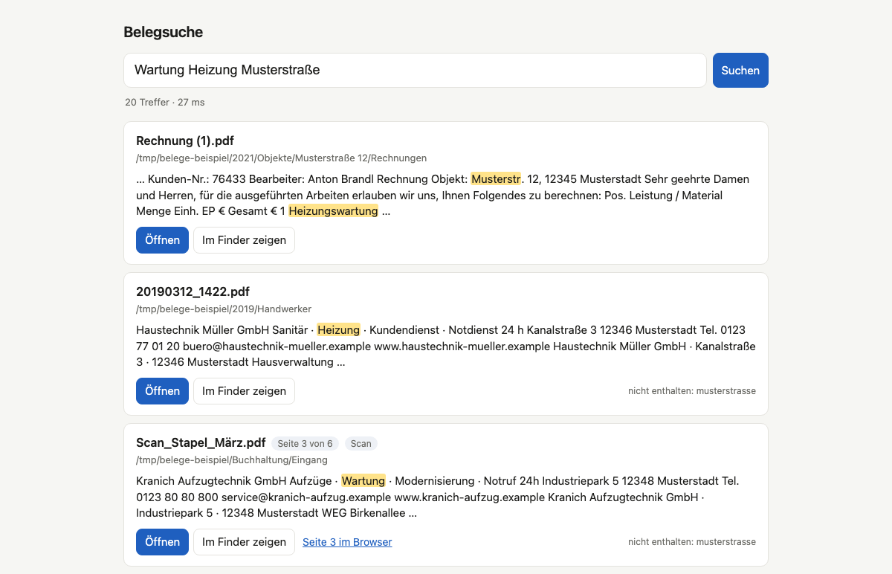

# Belegsuche

*In English:* Belegsuche is a local search tool for receipts, invoices and scanned documents on macOS.
It reads PDFs and images, recognizes text in scans with Apple's built-in Vision framework, and keeps the
search index on your Mac without changing the original files. The search is tuned for German documents
(amounts, invoice numbers, umlauts, street abbreviations, compound words, typos); the rest of this README is in German.

Belege, Rechnungen und Dokumente auf dem Mac durchsuchen – auch eingescannte, auch wenn die Datei
`Scan_00487.pdf` heißt und tief in einem Unterordner liegt.



*Beispiel mit dem erfundenen Testbestand aus `tools/make_testdata.py`.*

- **Lokal**: keine Cloud, keine laufenden Kosten. Texterkennung (OCR) mit Apples eingebautem Vision-Framework.
- **Originale bleiben unverändert**: Dateien werden nur gelesen. Der Suchindex liegt auf dem Mac
  (`~/Library/Application Support/Belegsuche/index.db`), nicht im durchsuchten Ordner.
- **Für deutsche Belege gebaut**: `1.234,56 €` = `1234,56` · `RE-2021/00487` = `2021-00487` = `RE 2021 00487` ·
  `Müller` = `Mueller` · `Musterstraße` = `Musterstr.` · `Heizung` findet `Heizungswartung` ·
  `Hausmeister` findet `Hauswart` · Tippfehler wie `Schornsteinfger` werden toleriert.
- **Treffer** mit Dateiname, Ordner, Seite und markiertem Textausschnitt; Öffnen oder im Finder zeigen per Klick.

## Installation

Voraussetzung: macOS 13 oder neuer, Python 3.11+ und Pillow 13.0.0+ (wird mitinstalliert).
Mit `python3 --version` prüfen: Bei Python 3.10 oder älter zuerst `brew install python@3.12` und im zweiten
Befehl `python3.12 -m venv .venv` statt `python3 -m venv .venv` verwenden.

```bash
git clone https://github.com/alsharmani0/belegsuche.git && cd belegsuche
python3 -m venv .venv && .venv/bin/pip install -e .
```

**Ohne Terminal:** Im Finder doppelklicken auf `Ordner einlesen.command` (Ordner wählen; „Abbrechen“ aktualisiert
nur die schon bekannten Ordner, danach folgt der Bericht) oder `Belegsuche starten.command` (öffnet die Suche im
Browser; das Terminalfenster offen lassen, solange gesucht wird). Beide erwarten die `.venv` im Projektordner wie oben
angelegt.

**Aktualisieren:** Die laufende Belegsuche und Einlese-Läufe beenden. Im Projektordner aktualisieren:

```bash
git pull &&
.venv/bin/python --version
```

Ab dieser Version werden Python 3.11+ und Pillow 13.0.0+ benötigt, weil ältere Pillow-Versionen bekannte
Sicherheitslücken in Bilddecodern enthalten. `git pull` allein aktualisiert die installierten Abhängigkeiten nicht.
Bei einer vorhandenen `.venv` mit Python 3.11 oder neuer:

```bash
.venv/bin/python -m pip install --upgrade -e . &&
.venv/bin/python -m pip check
```

Bei Python 3.10 oder älter die Umgebung mit einem neueren Interpreter neu anlegen; ein Paket-Upgrade in der
alten Umgebung reicht nicht. Der folgende Ablauf bewahrt die alte Umgebung in `.venv-alt` auf (dieser Name
muss noch frei sein). Nach erfolgreicher Installation kann sie gelöscht werden:

```bash
test ! -e .venv-alt && test ! -L .venv-alt &&
brew install python@3.12 &&
mv .venv .venv-alt &&
python3.12 -m venv .venv &&
.venv/bin/python -m pip install -e . &&
.venv/bin/python -m pip check
```

Scheitert ein Schritt nach dem Umbenennen, bleibt die alte Umgebung in `.venv-alt` erhalten. Zurücksetzen:
die unvollständige neue `.venv`, falls vorhanden, unter einem noch freien Namen beiseitelegen und `.venv-alt`
wieder `.venv` nennen. Vor dem nächsten Start muss die Umstellung auf Python 3.11+ und Pillow 13.0.0+ erfolgreich
abgeschlossen sein.

Der Standard-Suchindex liegt außerhalb der `.venv` und bleibt dabei erhalten. Die Originaldateien werden
durch diese Schritte nicht verändert. Wegen der editierbaren Installation verwenden `.venv/bin/belegsuche`
und beide `.command`-Starter den aktuellen Projektcode.
Ändert ein Update das Indexformat (zuletzt von 7 auf 8), baut der erste Aufruf den Suchindex einmalig neu auf,
siehe [Benutzung](#benutzung). Am besten das gleich
nach dem Update anstoßen: `Ordner einlesen.command` doppelklicken und „Abbrechen“ wählen. Messwerte, bekannte Grenzen
und offene Punkte: [docs/STAND.md](docs/STAND.md).

## Benutzung

```bash
# 1. Ordner einlesen (einmalig; bei großen Beständen Stunden bis Tage – Abbruch mit Ctrl+C jederzeit möglich,
#    beim nächsten Aufruf geht es an derselben Stelle weiter)
.venv/bin/belegsuche index "/Volumes/SSD/Belege"

# 2. Suchen im Browser
.venv/bin/belegsuche start

# oder in der Kommandozeile
.venv/bin/belegsuche suche Wartung Heizung Musterstraße

# Was ist durchsuchbar, was nicht (Fehler, Scans ohne Text, nicht unterstützte Dateien)?
.venv/bin/belegsuche bericht --csv ~/Desktop/probleme.csv

# Später: nur neue/geänderte Dateien nachziehen
.venv/bin/belegsuche index

# Dateien mit Fehlern erneut versuchen (z. B. nachdem die SSD mitten im Lauf abgezogen wurde)
.venv/bin/belegsuche index --fehler-wiederholen
```

Die Texterkennung läuft parallel in mehreren Prozessen (Standard: Anzahl Kerne − 2, höchstens 8;
ändern mit `--parallel N`). Ein zweiter gleichzeitiger Einlese-Lauf wird abgelehnt. Hängt eine Datei
(10 Minuten lang keine Seite fertig), werden die Prozesse neu gestartet und die Datei als Fehler gemeldet; die
übrigen Dateien werden danach weiter eingelesen. Das gilt nur für die parallele Verarbeitung, nicht für `--parallel 1`.

Geänderte Dateien bleiben bis zum nächsten `belegsuche index` mit ihrem bisherigen Text auffindbar und lassen sich
öffnen; die Suche kennzeichnet sie mit „geändert – wird neu eingelesen“.

Nach einem Update kann der erste Aufruf (`index`, `suche`, `start`, `bericht`, `test` oder `ordner`) länger dauern:
Ändert sich das Format des Suchindex (zuletzt auf Format 8, für Hausnummern bei getrennt geschriebenen Straßen wie
„Muster Str. 12“), wird er einmalig aus den gespeicherten Seitentexten neu aufgebaut – ohne neue Texterkennung.
Das meldet „Suchindex wird auf das neue Format umgestellt …“.

Die Suchoberfläche ist nur auf diesem Mac erreichbar (127.0.0.1) und lehnt Anfragen fremder Webseiten ab. Ein
Passwort hat sie nicht: Andere Benutzerkonten auf demselben Mac könnten sie aufrufen, solange sie läuft.

**SSD abgezogen?** Die Suche funktioniert weiter, nur Öffnen geht erst nach dem Anschließen. Ein Einlese-Lauf
ohne SSD ändert nichts; wird die SSD mitten im Lauf abgezogen, hält das Einlesen an und macht beim nächsten Start
weiter. Hängt die SSD später unter einem anderen Namen (z. B. „SSD 1“), erkennt `belegsuche index "/Volumes/SSD 1/…"`
das automatisch; von Hand geht es mit `belegsuche ordner` (zeigt die IDs) und `belegsuche ordner umziehen 1 "/Volumes/Neu"`.

**Eigene Synonyme**: Datei `synonyme.txt` im selben Ordner wie die Index-Datenbank (Standard:
`~/Library/Application Support/Belegsuche/`, bei `--db` neben dieser Datei), eine Gruppe pro Zeile:
`hausmeister, hauswart, objektbetreuer`. `#` leitet einen Kommentar ein. Die Suchoberfläche liest die Datei nur beim
Start: nach einer Änderung `belegsuche start` beenden (Ctrl+C) und neu starten.

**Weitere Optionen:** `belegsuche <befehl> --help`. Häufig gebraucht:

```bash
.venv/bin/belegsuche ordner entfernen 1              # Ordner mit ID 1 (siehe `belegsuche ordner`) aus dem Index nehmen;
                                                     # die Originale bleiben unberührt
.venv/bin/belegsuche index --fehlende-bestaetigen    # fehlende Dateien wirklich als gelöscht übernehmen, wenn das
                                                     # Einlesen das wegen „Achtung: … fehlen“ zurückgehalten hat
.venv/bin/belegsuche index --limit 20                # höchstens 20 Dateien verarbeiten (zum Ausprobieren)
.venv/bin/belegsuche suche --limit 30 Heizung        # mehr Treffer anzeigen (Standard: 10)
.venv/bin/belegsuche start --port 8766 --kein-browser   # anderer Port, Browser nicht automatisch öffnen
```

Einen anderen Index wählt man mit `--db PFAD` oder dauerhaft mit der Umgebungsvariable `BELEGSUCHE_DB`.

## Suchqualität messen

Eine CSV-Datei mit Suchfragen und dem jeweils erwarteten Dokument anlegen (Semikolon; `datei` ist der Pfad relativ
zum eingelesenen Ordner, alternativ `<Ordnername>/<Pfad>` oder der vollständige Pfad – bei gleichem relativem Pfad
in mehreren eingelesenen Ordnern den vollständigen Pfad angeben):

```
suche;datei;seite;notiz
Wartung Heizung Musterstraße;2021/Objekte/Scan_00487.pdf;1;Beschreibung
RE-2021/00487;2021/Objekte/Scan_00487.pdf;1;Nummer
```

```bash
.venv/bin/belegsuche test ~/Desktop/meine_suchen.csv
```

Ausgabe: wie oft das Dokument auf Platz 1 / unter den ersten 5 / unter den ersten 20 steht und bei jedem
Fehlschlag die Ursache: *Text/Format* (Datei nicht lesbar, nicht unterstützt oder ohne Text), *OCR* (Scan, in dem
die Texterkennung gar keinen Text gefunden hat), *OCR oder Wortwahl* (Begriff fehlt im erkannten Text
eines Scans – am Original prüfen, ob er dort steht), *Wortwahl* (Begriff steht nicht in der digitalen Textebene),
*Ranking* (gefunden, aber zu weit unten), *Index* (Datei nicht eingelesen oder Pfadangabe mehrdeutig).
Mit `--k 10` zählt „unter den ersten 10“ statt 5; `--json ~/Desktop/ergebnis.json` speichert das Ergebnis zusätzlich.

Vergleich der Texterkennung: denselben Ordner zusätzlich mit Tesseract in eine eigene Datenbank einlesen
und dieselbe Liste testen. Tesseract ist nicht in macOS enthalten: `brew install tesseract tesseract-lang` (das zweite
Paket bringt das deutsche Sprachmodell). Eigene Synonyme vorher nach `/tmp/synonyme.txt` kopieren, sonst gelten
dort nur die eingebauten.

```bash
.venv/bin/belegsuche --db /tmp/tess.db index "/Pfad/zum/Testordner" --ocr tesseract
.venv/bin/belegsuche --db /tmp/tess.db test ~/Desktop/meine_suchen.csv
```

## Unterstützte Dateien

PDF (mit Textebene oder gescannt), JPG, PNG, TIFF (mehrseitig), HEIC, BMP, GIF, WebP.
Andere Dateien (Word, Excel, E-Mails, ZIP) werden im Bericht als „nicht unterstützt“ gezählt.

## Entwicklung

```bash
.venv/bin/pip install -e ".[dev]"
.venv/bin/pytest
.venv/bin/python tools/make_testdata.py          # künstlicher Testbestand in testdata/
```

Suchqualität auf dem künstlichen Testbestand nachmessen (Soll: 26/26 und 16/16 auf Platz 1):

```bash
.venv/bin/belegsuche --db /tmp/korpus.db index testdata/korpus
.venv/bin/belegsuche --db /tmp/korpus.db test testdata/queries_dev.csv
.venv/bin/belegsuche --db /tmp/korpus.db test testdata/queries_holdout.csv
```

In der CI (GitHub Actions, Python 3.11 und 3.12) werden Vision-Tests übersprungen, falls der Runner keinen Text
erkennt; lokal laufen sie immer. Übersprungene Tests stehen als Warnung in der Zusammenfassung des Laufs.

Lizenz: MIT
