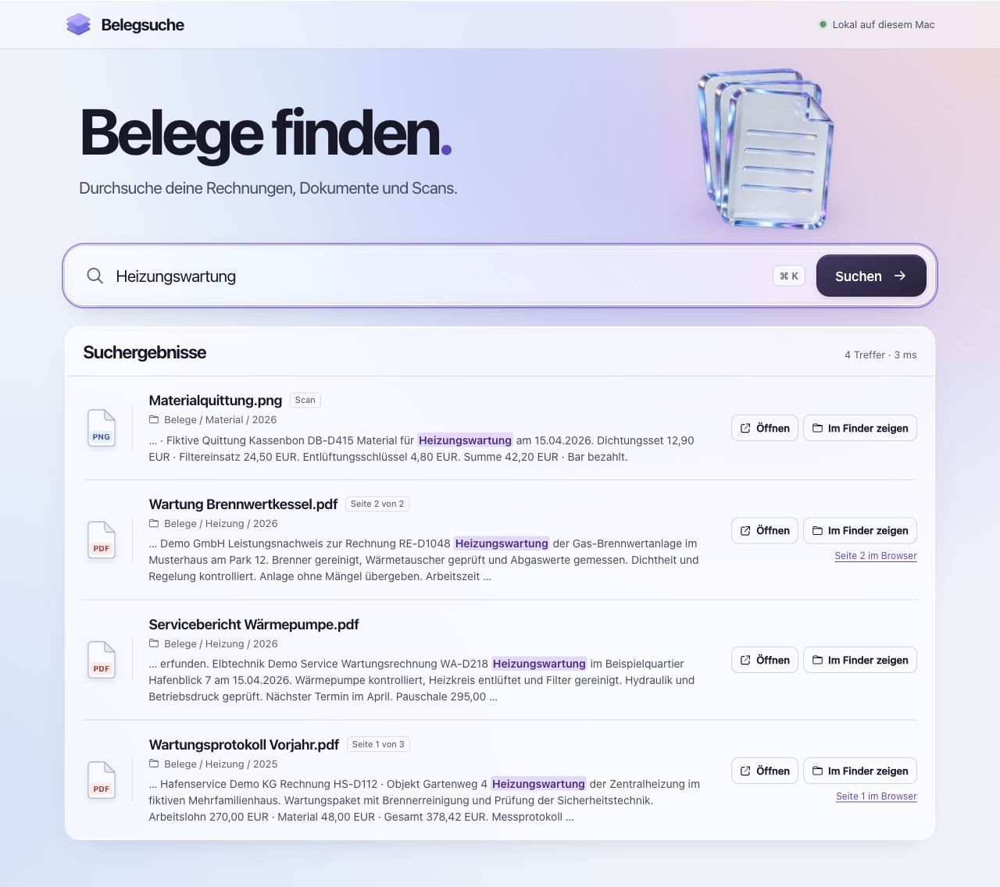

# Belegsuche

Belegsuche findet Rechnungen, Belege und Scans auf deinem Mac – auch in E-Mails (.eml) samt Anhängen und in
Word-Dateien. Suche zum Beispiel nach Firma, Betrag oder Rechnungsnummer – auch wenn die Datei nur
`Scan_00487.pdf` heißt. Die Trefferliste zeigt die Fundstelle und die Seite; von dort öffnest du den Beleg oder
zeigst ihn im Finder an.

[Schnellstart](#installation) · [Aktualisieren](#aktualisieren) · [Messwerte und bekannte Grenzen](docs/STAND.md)

*In English: Local, offline search for receipts, invoices and scans on macOS, with on-device OCR
and search rules for German documents. Originals stay unchanged.*

<picture>
  <source media="(prefers-color-scheme: dark)" srcset="docs/screenshot-dunkel.jpg">
  
</picture>

*Beispiel mit fiktiven Belegen. Die Oberfläche folgt dem hellen oder dunklen Erscheinungsbild des Systems.
Mit ⌘ K springt man ins Suchfeld, mit Esc zurück zur Ordnerübersicht.*

- **Lokal**: keine Cloud, keine laufenden Kosten. Texterkennung (OCR) mit Apples eingebautem Vision-Framework.
- **Originale bleiben unverändert**: Dateien werden nur gelesen. Der Suchindex liegt auf dem Mac
  (`~/Library/Application Support/Belegsuche/index.db`), nicht im durchsuchten Ordner.
- **Für deutsche Belege gebaut**: `1.234,56 €` = `1234,56` · `RE-2021/00487` = `2021-00487` = `RE 2021 00487` ·
  `Müller` = `Mueller` · `Musterstraße` = `Musterstr.` · `Heizung` findet `Heizungswartung` ·
  `Hausmeister` findet `Hauswart` · Tippfehler wie `Schornsteinfger` werden toleriert.
- **Treffer** mit Dateiname, Ordner, Seite und markiertem Textausschnitt; Öffnen oder im Finder zeigen per Klick.
- **E-Mails mit Anhängen**: Ein Treffer in einer Mail nennt Betreff, Absender und Datum und, falls die Fundstelle
  in einem Anhang liegt, den Anhang und die Seite darin („Anhang 2: Rechnung.pdf, Seite 3/5“). In der Oberfläche
  öffnet „Mail öffnen“ die `.eml` mit Apple Mail. „Anhang öffnen“ legt eine schreibgeschützte Kopie des Anhangs in
  einen eigenen Ordner im System-Temp (nie neben die Mail) und öffnet sie; „Seite 3 im Browser“ zeigt PDF-Anhänge
  direkt an der Fundstelle. Nur unterstützte Anhänge, deren Inhalt noch zum Index passt, lassen sich öffnen.
  Kann macOS die Kopie nicht als „aus dem Internet geladen“ markieren, öffnet Belegsuche sie nicht. Beim Beenden
  werden eigene, unveränderte Kopien entfernt. Beim nächsten Start kommen dafür nur verwaiste Kopien über
  24 Stunden mit Besitznachweis infrage. Aktive Sitzungen, unbekannte Altordner und Archivwurzeln bleiben erhalten.
  Bei DOMUS-Platzhaltern öffnet „In DOMUS abgelegt“ den Beleg im Vorgangsordner. Kommt der Beleg später hinzu,
  lässt sich der Verweis nach dem nächsten Einlesen dieses Ordners nutzen.
- **Word-Dateien** öffnen als schreibgeschützte Kopie im System-Temp: Word legt so keine Sperrdatei (`~$…`) neben
  das Original und kann nicht ins Original speichern. Eine vorhandene macOS-Quarantänemarkierung bleibt auf der
  Kopie erhalten. „Im Finder zeigen“ zeigt das Original.

## Installation

Voraussetzung: macOS 13 oder neuer, Python 3.11+ und Pillow 13.0.0+ (wird mitinstalliert).
Mit `python3 --version` prüfen: Bei Python 3.10 oder älter zuerst `brew install python@3.12` und im zweiten
Befehl `python3.12 -m venv .venv` statt `python3 -m venv .venv` verwenden.

```bash
git clone https://github.com/alsharmani0/belegsuche.git && cd belegsuche
python3 -m venv .venv && .venv/bin/pip install -e .
```

**Nach der Installation im Finder:**

1. `Ordner einlesen.command` doppelklicken und deinen Belegordner auswählen. Am Ende zeigt der Bericht,
   welche Dateien durchsuchbar sind. „Abbrechen“ im Auswahldialog aktualisiert die bereits bekannten Ordner.
2. `Belegsuche starten.command` doppelklicken. Die Suche öffnet sich im Browser; das Terminalfenster offen
   lassen, solange du suchst.

## Benutzung

```bash
# 1. Ordner einlesen (einmalig; bei großen Beständen Stunden bis Tage – Abbruch mit Ctrl+C jederzeit möglich,
#    beim nächsten Aufruf geht es an derselben Stelle weiter)
.venv/bin/belegsuche index "/Volumes/SSD/Belege"

# 2. Suchen im Browser
.venv/bin/belegsuche start

# oder in der Kommandozeile
.venv/bin/belegsuche suche Wartung Heizung Musterstraße

# Was ist durchsuchbar, was nicht (Fehler, Scans ohne Text, nicht unterstützte Dateien)?
.venv/bin/belegsuche bericht --csv probleme.csv

# Später: nur neue/geänderte Dateien nachziehen
.venv/bin/belegsuche index

# Dateien mit Fehlern erneut versuchen (z. B. nachdem die SSD mitten im Lauf abgezogen wurde),
# auch Mails, denen wegen eines Zeitlimits oder vorübergehenden Lesefehlers Anhangstext fehlt
.venv/bin/belegsuche index --fehler-wiederholen

# Einmal nach einem Update: Mails neu lesen, deren Kopf noch einen Vermerk einer früheren Version zeigt
# („Entwurf“ bei gesendeten CRM-Mails, alter Datumszusatz) – ohne neue Texterkennung
.venv/bin/belegsuche index --mailkopf-erneuern
```

Die Texterkennung läuft parallel in mehreren Prozessen (Standard: Anzahl Kerne − 2, höchstens 8;
ändern mit `--parallel N`). Ein zweiter gleichzeitiger Einlese-Lauf wird abgelehnt. Hängt eine Datei
(10 Minuten lang keine Seite fertig), werden die Prozesse neu gestartet und die Datei wird einmal allein wiederholt
(Zeitlimit dann 2 Minuten) – unter Last hängt Vision gelegentlich bei Dateien, die allein in Sekunden durchgehen.
Hängt sie wieder, ist sie ein Fehler; eine E-Mail wird dann nur mit dem Mailtext eingelesen, ihre PDF- und
Bild-Anhänge holt `--fehler-wiederholen` später nach. Die übrigen Dateien werden weiter eingelesen. Die Stapelspur
jedes Hängers steht in `zeitlimit.log` neben der Index-Datei. Das gilt nur für die parallele Verarbeitung, nicht für
`--parallel 1`.

Sobald ein Einlese-Lauf eine Änderung erkennt, bleibt die Datei mit ihrem bisherigen Text auffindbar, bis der
neue Text fertig ist. In dieser Zeit kennzeichnet die Suche sie mit „geändert – wird neu eingelesen“.
Ein Aufruf mit Ordnerargument verarbeitet nur die angegebenen Ordner; ohne Argument werden alle bekannten aktualisiert.
Während des Einlesens lassen sich diese Ordner nicht über einen zweiten Aufruf umziehen oder entfernen.

Umbenannte oder innerhalb eines Ordners verschobene Dateien erkennt `belegsuche index` am Inhalt: Der Text wird
übernommen (keine neue Texterkennung), der alte Eintrag entfernt, die Zusammenfassung meldet „umbenannt/verschoben: N“.
Gelöschte Dateien ohne Gegenstück zählt der Bericht weiter unter „fehlen im Ordner“. Wirken Datei- oder Ordnernamen
beim Kopieren beschädigt (z. B. `šbergabe` statt `Übergabe`, typisch für die Windows App), zeigt der Bericht
„Dateinamen mit beschädigten Umlauten: N“ mit Vorschlägen; umbenannt wird nichts automatisch.

Nach einem Update kann der erste Aufruf (`index`, `suche`, `start`, `bericht`, `test` oder `ordner`) länger dauern:
Format 9 unterscheidet Hausnummernlisten von Bereichen: „Musterweg 7, 11“ enthält nicht die Nummer 9,
„Musterweg 7–11“ dagegen schon. Die Umstellung benötigt Schreibzugriff auf die Datenbank und nutzt die bereits
gespeicherten Seitentexte, auch wenn die Originale offline sind. Ein aktueller Index lässt sich schreibgeschützt
durchsuchen und auswerten. Die Umstellung führt keine neue Texterkennung aus: Um eine verbesserte OCR an
unveränderten Originalen zu vergleichen, mit `--db` einen neuen Index anlegen und den bisherigen behalten.

Die Suchoberfläche ist nur auf diesem Mac erreichbar (127.0.0.1) und lehnt Anfragen fremder Webseiten ab. Ein
Passwort hat sie nicht: Andere Benutzerkonten auf demselben Mac könnten sie aufrufen, solange sie läuft.
Ist der Port schon belegt, öffnet der Starter keinen Browser: Es ist nicht bekannt, welcher Dienst oder
Index dort läuft. Eine vorhandene Suche im offenen Fenster nutzen oder für einen zweiten Index `--port 8766` wählen.

**SSD abgezogen?** Die Suche funktioniert weiter, nur Öffnen geht erst nach dem Anschließen. Ein Einlese-Lauf
ohne SSD ändert nichts; wird die SSD mitten im Lauf abgezogen, hält das Einlesen an und macht beim nächsten Start
weiter. Hängt die SSD später unter einem anderen Namen (z. B. „SSD 1“), erkennt `belegsuche index "/Volumes/SSD 1/…"`
das automatisch; von Hand geht es mit `belegsuche ordner` (zeigt die IDs) und `belegsuche ordner umziehen 1 "/Volumes/Neu"`.

**Eigene Synonyme**: Datei `synonyme.txt` im selben Ordner wie die Index-Datenbank (Standard:
`~/Library/Application Support/Belegsuche/`, bei `--db` neben dieser Datei), eine Gruppe pro Zeile:
`hausmeister, hauswart, objektbetreuer`. `#` leitet einen Kommentar ein. Die Suchoberfläche liest die Datei nur beim
Start: nach einer Änderung `belegsuche start` beenden (Ctrl+C) und neu starten.

**Weitere Optionen:** `belegsuche <befehl> --help`. Häufig gebraucht:

```bash
.venv/bin/belegsuche ordner entfernen 1              # Ordner mit ID 1 (siehe `belegsuche ordner`) aus dem Index nehmen;
                                                     # die Originale bleiben unberührt
.venv/bin/belegsuche index --fehlende-bestaetigen    # fehlende Dateien wirklich als gelöscht übernehmen, wenn das
                                                     # Einlesen das wegen „Achtung: … fehlen“ zurückgehalten hat
.venv/bin/belegsuche index --limit 20                # höchstens 20 Dateien verarbeiten (zum Ausprobieren)
.venv/bin/belegsuche suche --limit 30 Heizung        # mehr Treffer anzeigen (Standard: 10)
.venv/bin/belegsuche start --port 8766 --kein-browser   # anderer Port, Browser nicht automatisch öffnen
```

Einen anderen Index wählt man mit `--db PFAD` oder dauerhaft mit der Umgebungsvariable `BELEGSUCHE_DB`.
Die Datenbank muss außerhalb der Belegordner liegen. CSV-/JSON-Exporte dürfen den Index, dessen SQLite-Hilfsdateien,
die Eingabe-CSV und vorhandene Dateien in den Belegordnern nicht überschreiben. Eine bestehende Ausgabedatei
außerhalb dieser Ordner wird erst nach einem vollständig geschriebenen Export ersetzt.

## Aktualisieren

Die laufende Belegsuche und Einlese-Läufe beenden. Im Projektordner aktualisieren:

```bash
git pull &&
.venv/bin/python --version
```

Ab dieser Version werden Python 3.11+ und Pillow 13.0.0+ benötigt, weil ältere Pillow-Versionen bekannte
Sicherheitslücken in Bilddecodern enthalten. `git pull` allein aktualisiert die installierten Abhängigkeiten nicht.
Bei einer vorhandenen `.venv` mit Python 3.11 oder neuer:

```bash
.venv/bin/python -m pip install --upgrade -e . &&
.venv/bin/python -m pip check
```

Bei Python 3.10 oder älter die Umgebung mit einem neueren Interpreter neu anlegen; ein Paket-Upgrade in der
alten Umgebung reicht nicht. Der folgende Ablauf bewahrt die alte Umgebung in `.venv-alt` auf (dieser Name
muss noch frei sein). Nach erfolgreicher Installation kann sie gelöscht werden:

```bash
test ! -e .venv-alt && test ! -L .venv-alt &&
brew install python@3.12 &&
mv .venv .venv-alt &&
python3.12 -m venv .venv &&
.venv/bin/python -m pip install -e . &&
.venv/bin/python -m pip check
```

Scheitert ein Schritt nach dem Umbenennen, bleibt die alte Umgebung in `.venv-alt` erhalten. Zurücksetzen:
die unvollständige neue `.venv`, falls vorhanden, unter einem noch freien Namen beiseitelegen und `.venv-alt`
wieder `.venv` nennen. Vor dem nächsten Start muss die Umstellung auf Python 3.11+ und Pillow 13.0.0+ erfolgreich
abgeschlossen sein.

Der Standard-Suchindex liegt außerhalb der `.venv` und bleibt dabei erhalten. Die Originaldateien werden
durch diese Schritte nicht verändert. Wegen der editierbaren Installation verwenden `.venv/bin/belegsuche`
und beide `.command`-Starter den aktuellen Projektcode.
Ein `belegsuche bericht` genügt, um die Datenbankstruktur umzustellen. Das eigentliche Nachlesen betroffener
Anhänge aus den Originalen erfolgt erst mit `belegsuche index`, siehe [Unterstützte Dateien](#unterstützte-dateien).
Messwerte, bekannte Grenzen und offene Punkte: [docs/STAND.md](docs/STAND.md).

## Suchqualität messen

Eine CSV-Datei mit Suchfragen und dem jeweils erwarteten Dokument anlegen (Semikolon; `datei` ist der Pfad relativ
zum eingelesenen Ordner, alternativ `<Ordnername>/<Pfad>` oder der vollständige Pfad – bei gleichem relativem Pfad
in mehreren eingelesenen Ordnern den vollständigen Pfad angeben):

```
suche;datei;seite;notiz
Wartung Heizung Musterstraße;2021/Objekte/Scan_00487.pdf;1;Beschreibung
RE-2021/00487;2021/Objekte/Scan_00487.pdf;1;Nummer
```

Bei einer Mail zählt `seite` ab dem Mailtext über **alle** Anhänge hinweg. Um gezielt die zweite Seite eines
PDF-Anhangs zu prüfen, können die optionalen Spalten `teil` und `teilseite` verwendet werden. `teil=0` steht für
den Mailtext, die weiteren Teilnummern entsprechen der Anzeige. `teilseite` beginnt bei 1 und benötigt `teil`.

```text
suche;datei;teil;teilseite
Materialprüfung;Beispiele/Unterlagen.eml;1;2
```

Ein Treffer unter „auch unter“ zählt mit den Seiten der erwarteten Datei. Die Dateiränge (Platz 1, Top 5 usw.)
bleiben mit bisherigen Auswertungen vergleichbar. Im JSON zählt `ziel_top_5` beim Standardwert `--k 5` nur
Fälle, bei denen zusätzlich alle vorgegebenen Fundstellenangaben stimmen. Alle Fragen eines Laufs verwenden
denselben Indexstand, auch während ein anderer Prozess neue Belege einliest.

```bash
.venv/bin/belegsuche test meine_suchen.csv
```

Ausgabe: wie oft das Dokument auf Platz 1 / unter den ersten 5 / unter den ersten 20 steht und bei jedem
Fehlschlag die Ursache: *Text/Format* (Datei nicht lesbar, nicht unterstützt oder ohne Text), *OCR* (Scan, in dem
die Texterkennung gar keinen Text gefunden hat), *OCR oder Wortwahl* (Begriff fehlt im erkannten Text
eines Scans – am Original prüfen, ob er dort steht), *Wortwahl* (Begriff steht nicht in der digitalen Textebene),
*Ranking* (gefunden, aber zu weit unten), *Index* (Datei nicht eingelesen oder Pfadangabe mehrdeutig).
Mit `--k 10` zählt „unter den ersten 10“ statt 5 (zulässig: 1 bis 50); `--json ergebnis.json` speichert das Ergebnis zusätzlich.

Vergleich der Texterkennung: denselben Ordner zusätzlich mit Tesseract in eine eigene Datenbank einlesen
und dieselbe Liste testen. Tesseract ist nicht in macOS enthalten: `brew install tesseract tesseract-lang` (das zweite
Paket bringt das deutsche Sprachmodell). Eigene Synonyme vorher nach `/tmp/synonyme.txt` kopieren, sonst gelten
dort nur die eingebauten.

```bash
.venv/bin/belegsuche --db /tmp/tess.db index "/Pfad/zum/Testordner" --ocr tesseract
.venv/bin/belegsuche --db /tmp/tess.db test meine_suchen.csv
```

## Unterstützte Dateien

- PDF (mit Textebene oder gescannt), JPG, PNG, TIFF (mehrseitig), HEIC, BMP, GIF, WebP.
- **Word**: `.docx`, `.dotx`, `.dotm` (direkt gelesen, mit Kopf- und Fußzeilen, auch Strict-OOXML), `.doc`,
  `.dot`, `.rtf`, `.odt` (über das macOS-Programm `textutil`, das die Datei nur über die Standardeingabe bekommt;
  Feldbefehle wie `MERGEFIELD` oder `SYMBOL` werden aus dem Text entfernt). Als `.doc` gespeichertes HTML,
  Word-2003-XML oder reiner Text wird ebenfalls gelesen (HTML ohne Nachladen aus dem Netz). Bilder in Word-Dateien
  werden nicht per Texterkennung gelesen; hat eine Datei fast keinen Text, steht ein Hinweis im Bericht.
- **E-Mails** (`.eml`): Seite 1 enthält Betreff, Von, An, Cc, Datum und den Mailtext (HTML-Mails als Text, ohne
  Nachladen von Bildern). Danach folgen die Seiten der Anhänge: PDF, Bilder (mit Texterkennung), Word, Text und
  angehängte Mails (bis Tiefe 2). Die Art eines Anhangs wird am Inhalt erkannt, nicht am Namen. Betreff und
  Absender zählen bei allen Seiten einer Mail mit, so findet „Absender + Betrag“ auch den Betrag im Anhang.
  Die Namen der Anhänge stehen auf Seite 1, zählen bei der Suche aber nur so viel wie ein Dateiname: Wer nach
  einem Dateinamen sucht, bekommt die Datei vor der Mail, die sie nur nennt.
  - Fehlt der Date-Kopf (viele Mails aus dem DOMUS-CRM), zeigt der Treffer die Speicherzeit der Datei mit dem
    Zusatz „(Speicherdatum, nicht Sendedatum)“. Sie sagt nicht, wann die Mail geschrieben oder gesendet wurde,
    und ist nicht als Datum durchsuchbar.
  - Eine Mail mit `X-Unsent: 1` trägt im Kopf den Vermerk „Entwurf (nicht gesendet)“. Das DOMUS-CRM legt aber
    auch seine gesendeten Mails so ab und vermerkt den Versand in `X-tblEMail-Typ: Sent`; dann steht dort
    „Aus dem CRM gesendet“. Beide Vermerke werden angezeigt, zählen aber nicht als Mailtext. Ein Index aus
    einer früheren Version zeigt bei gesendeten CRM-Mails noch „Entwurf (nicht gesendet)“ und den alten
    Datumszusatz, bis `belegsuche index --mailkopf-erneuern` diese Mails einmal neu gelesen hat.
  - Kopfzeilen mit rohen Umlauten in Latin-1/Windows-1252 (alte Programme) werden richtig gelesen, ebenso
    Mailtexte, die als UTF-8 angegeben, aber in Windows-1252 geschrieben sind.
  - Kleine Bilder im Mailtext (Signatur-Logos), gleiche Bilder in derselben Mail und Signaturen (`smime.p7s`)
    werden übersprungen. Ein Anhang mit demselben Inhalt wie eine schon eingelesene Datei oder ein Anhang einer
    anderen Mail übernimmt deren Text – ohne neue Texterkennung.
  - DOMUS-Platzhalter („Die Datei '…' wurde in die Dokumentenverwaltung von DOMUS … verschoben“) werden als
    Verweis auf die gleichnamige Datei im Vorgangsordner (Ordner über `Emails/`) gespeichert; der Dateiname steht
    im Mailtext („Anhang in DOMUS abgelegt: …“).
  - **`winmail.dat`** (Outlook, Format TNEF; erkannt am Inhalt, auch unter anderem Namen wie `ATT00001.dat`): Die
    Anhänge darin (PDF, Bilder, Word …) werden wie normale Anhänge gelesen und durchsucht; ein Treffer darin zeigt
    „(aus winmail.dat)“ – auch unter „auch unter“ – und lässt sich wie jeder Anhang öffnen. Signatur-Logos und
    reine Formatierung fallen weg.
    In der `winmail.dat` eingebettete Outlook-Nachrichten werden wie weitergeleitete Mails gelesen. Hat die Mail
    selbst keinen Text, gilt der Text aus der `winmail.dat`. Ist sie kaputt oder abgeschnitten, wird gelesen, was
    lesbar ist; der Rest steht als Hinweis am Anhang. Präparierte Dateien bremsen das Einlesen nicht aus
    (Grenzen für Eigenschaften je Mail und für die Länge von Namen).
  - Nicht ausgewertet (Hinweis am Anhang, kein Fehler der Mail): Excel, ZIP, Videos, Anhänge über 50 MB
    (`winmail.dat` über 100 MB), passwortgeschützte PDFs. Höchstens 60 Anhänge und 1000 Seiten je Mail (Anhänge in
    einer `winmail.dat` zählen mit).
  - Hängt die Texterkennung eines Anhangs oder stürzt sie wiederholt ab, wird die Mail nur mit Mailtext (ohne
    PDF- und Bild-Anhänge) eingelesen und im Bericht markiert.
  - Bei einzelnen vorübergehenden Anhangfehlern bleibt der Mailtext durchsuchbar. Der Bericht nennt die
    betroffenen Teilnummern. `index --fehler-wiederholen` versucht diese Anhänge erneut; ein unvollständiger
    Mailstand wird nicht an bytegleiche Mailkopien weitergegeben.
  - Weiche Umbrüche in `text/plain; format=flowed` zerlegen Suchwörter und Rechnungsnummern nicht.
    Als `.doc` angehängtes HTML, Word-2003-XML und Klartext werden ebenfalls durchsucht (Textvarianten bis
    5 MiB). Beim Öffnen einer solchen Anlage erhält man den erkannten Inhalt als UTF-8-Textdatei.
  - Steckt derselbe Anhang in mehreren Mails, die gleichzeitig gelesen werden, wartet die zweite Mail, bis er
    einmal erkannt ist, und übernimmt dann den Text.
- Outlook-`.msg`, Excel und ZIP werden im Bericht als „nicht unterstützt“ gezählt. Der Bericht nennt außerdem
  die Zahl der eingelesenen E-Mails und Word-Dateien, wie viele Mail-Anhänge ausgewertet, übernommen,
  als Platzhalter erkannt oder nicht ausgewertet wurden und wie viele `winmail.dat` geöffnet wurden (davon nur mit
  Logos bzw. ohne Anhänge, mit der Zahl der Anhänge darin und dem Grund, falls eine nicht lesbar war) – und wie
  viele noch nicht geöffnet sind, weil sie eine frühere Version eingelesen hat.

**Bestehender Index.** Die Umstellung von Format 9 bis 12 auf Format 13 erhält den Volltextindex.
Beim nächsten `index` liest das Programm in den ausgewählten Ordnern ältere TNEF-Mails erneut.
Dadurch werden auch UTF-16-Mailtexte und Texte hinter eingebetteten RTF-Bildern auffindbar.
Für Indizes vor Format 12 prüft es zusätzlich frühere Fehlklassifikationen wie als PDF gespeicherte
`.dat`-Container und übersprungene Word-Anhänge. Vollständig erkannte, wiederverwendbare PDF- und Bildseiten
werden übernommen. Unerreichbare Originale werden erst bei einem späteren Lauf geprüft.

Hat eine ältere Version zu wenige Seiten aus einer eigenständigen Datei in einen Mail-Anhang übernommen,
kann `index` das korrigieren, solange der Index den Kürzungshinweis der Quelldatei noch enthält.
Fehlt dieser Nachweis, lässt sich eine verdächtige Mail in einer separaten neuen Datenbank vollständig prüfen.

Die Umstellung liest nicht pauschal alle Mailtexte und Word-Originale neu. Fehlt in einem bereits gespeicherten
Mailtext etwa ein durch weichen Zeilenumbruch geteiltes Wort, lässt sich die neue Erkennung für den
betroffenen Ordner mit einer **separaten, neuen** `--db` nutzen. Den bisherigen Index dafür nicht löschen.

## Entwicklung

```bash
.venv/bin/pip install -e ".[dev]"
.venv/bin/pytest
```

In einem frischen Checkout erzeugt `.venv/bin/python tools/make_testdata.py` den fehlenden künstlichen
Korpus. Einen vorhandenen Korpus prüft `.venv/bin/python tools/check_testdata.py` ohne Neugenerierung.
Für einen unabhängigen Generierungs- und Suchtest in einem neuen Ordner:

```bash
testlauf=$(mktemp -d)
.venv/bin/python tools/make_testdata.py --output "$testlauf/daten"
.venv/bin/python tools/check_testdata.py --testdata "$testlauf/daten"
.venv/bin/belegsuche --db "$testlauf/korpus.db" index "$testlauf/daten/korpus"
.venv/bin/belegsuche --db "$testlauf/korpus.db" test "$testlauf/daten/queries_dev.csv"
# Erst zum Abschluss; die Holdout-Fragen nicht zum Anpassen der Suche verwenden.
.venv/bin/belegsuche --db "$testlauf/korpus.db" test "$testlauf/daten/queries_holdout.csv"
```

In der CI (GitHub Actions, Python 3.11 und 3.12) werden Vision-Tests übersprungen, falls der Runner keinen Text
erkennt; lokal laufen sie immer. Übersprungene Tests stehen als Warnung in der Zusammenfassung des Laufs.

Lizenz: MIT
